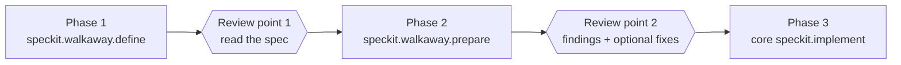

# Walkaway

A [Spec Kit](https://github.com/github/spec-kit) extension that runs spec-driven
development in three human-reviewed phases straight from your agent chat. Start a phase,
walk away, and come back to a review point.

It is built for VS Code Copilot Chat, where the `specify workflow run` engine is not
available, and also works in Claude Code.

## The three-phase flow



- **Phase 1, define**: runs core specify (with no questions), then core clarify
  interactively, one question at a time.
- **Review point 1**: you read the clarified spec and the summary, then decide to
  continue.
- **Phase 2, prepare**: runs core plan, tasks, and analyze with no questions.
- **Review point 2**: findings grouped by severity and one question, "Apply fixes?
  (yes/no)". A yes runs a bounded fix loop (default 3 rounds, 1–5 allowed).
- **Phase 3**: the unchanged core implement command, started by you.

Every phase ends with the same fixed summary (Status, Files, Decisions, Open points or
Findings by severity, Needs your decision, Next step) and a hard stop.

## Requirements

- Spec Kit `specify-cli` 0.12.17 or later, in a project initialised with `specify init`
  and a ratified constitution.
- VS Code with GitHub Copilot Chat (Agent mode), or Claude Code.

## Installation

From a release archive:

```text
specify extension add walkaway --from https://github.com/<owner>/spec-kit-walkaway/archive/refs/tags/v1.0.0.zip
```

From the community catalog (once listed):

```text
specify extension add walkaway
```

For local development, from a clone of this repository:

```text
specify extension add --dev <path-to-spec-kit-walkaway>
```

## Usage

Commands are shown in dotted form; type them the way your agent lists them (for
example `/speckit-walkaway-define` in Copilot Chat skills mode and Claude Code).

```text
speckit.walkaway.define Photo album app with shared albums
speckit.walkaway.prepare          # 3 fix rounds at most
speckit.walkaway.prepare 2        # 2 fix rounds at most, this run only
```

Re-running is safe:

- `define` with no description, or with the same description as the current spec,
  re-runs clarification on the current feature. A different description starts a new
  feature. It never asks anything besides clarification questions.
- `prepare` regenerates plan and tasks, lists replaced files, and refuses to run once a
  task is marked done or while `[NEEDS CLARIFICATION: …]` markers remain in the spec.

See [docs/usage.md](docs/usage.md) for every stop point and the troubleshooting guide.

## Running unattended

Your agent may still ask you to approve terminal commands or file edits, which pauses an
unattended run. Configure narrow approvals for the Spec Kit scripts and feature files as
described in [docs/usage.md](docs/usage.md#running-unattended). Avoid blanket
auto-approval.

## What it never does

- It registers no hooks and ships no scripts.
- It never starts implementation or the next phase on its own.
- It never modifies core Spec Kit commands, the constitution, or files outside the
  current feature directory.

## Documentation

- [docs/usage.md](docs/usage.md): phases, inputs, stop points, re-run rules,
  troubleshooting
- [docs/testing.md](docs/testing.md): automated checks and the manual test protocol with
  results
- [CHANGELOG.md](CHANGELOG.md)

## License

[MIT](LICENSE)
